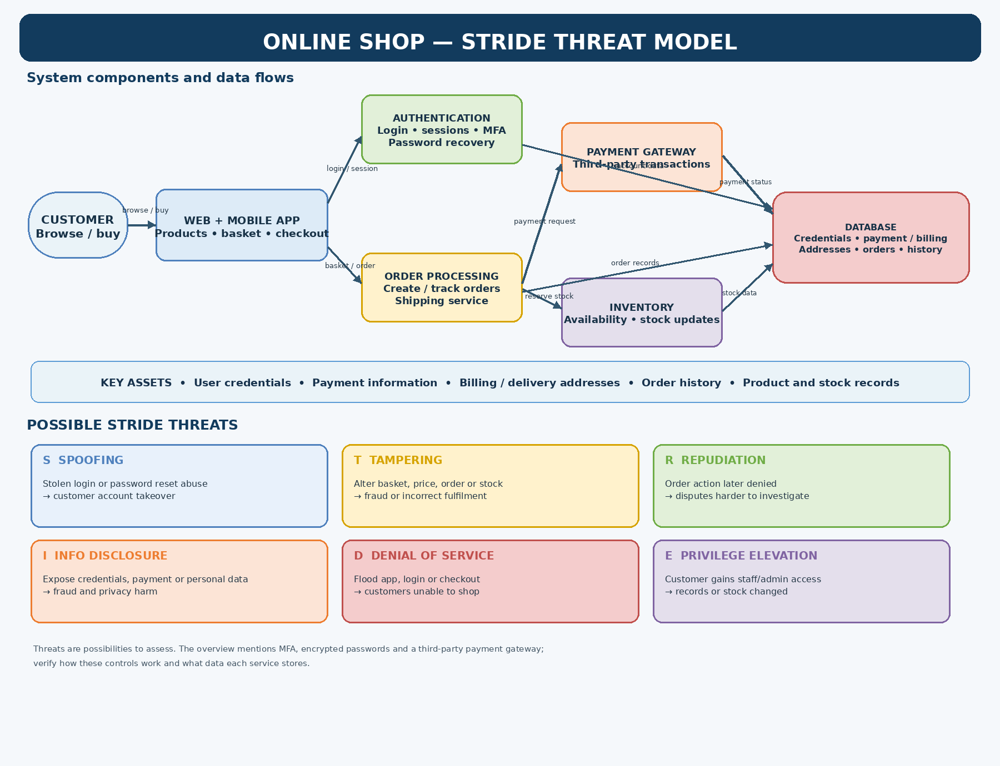

# Wayne Hudson | Cyber Security Portfolio

I am building a career in cyber security and continuing to develop my knowledge through formal study and practical projects. This portfolio records what I have learned and the work I complete as I progress.

## Qualifications and study

### NCFE Level 2 Certificate in the Principles of Cyber Security — completed

The course gave me a foundation in cyber security concepts, common threats, safe working practices, and the importance of communication and teamwork.

I studied:

- **Cyber security foundations:** why cyber security matters, the impact and motivations behind cyber crime, threat actors, attack types, and cyber security roles.
- **Core terminology and systems:** vulnerabilities, threats, risk, attacks, protection and recovery; hardware, software, data management, networking, LANs and WANs.
- **Social engineering:** phishing and other techniques used to manipulate people.
- **Legal and ethical responsibilities:** protecting data, understanding legal responsibilities, and distinguishing ethical from unethical conduct.
- **Common threats:** malware, how systems can become infected, malware removal, emerging threats, and physical security risks affecting devices, networks and remote working.
- **Protective measures:** user access control, firewalls, updates and patching, vulnerability testing, and penetration testing.
- **Working with others:** communication, teamwork, interpersonal skills, conflict resolution, and written communication in a cyber security setting.

This study developed my understanding of foundational security principles, common threats, legal and ethical responsibilities, basic protective measures, and the value of clear communication.

### NCFE Level 3 Certificate in Cyber Security Practices — in progress

I am currently studying the NCFE Level 3 Certificate in Cyber Security Practices (60357629). The course is in progress; it is not yet a completed qualification.

**Progress so far:**

- Completed the Unit 1 Section 1 Learning Package.
- Submitted Unit 1 Question 1, covering security concepts, identity, confidentiality, integrity, availability, threats, vulnerabilities, risks and hazards.
- Prepared a [Unit 1 foundations study note](study-notes/cyber-security-foundations.md) summarising these concepts.

## Projects

### Online shop STRIDE threat model

A learning exercise mapping a hypothetical online shop and applying the STRIDE model to identify security threats for further assessment.

**System components mapped:** customer, web and mobile application, authentication, order processing, payment gateway, inventory, and database. The diagram also shows example data flows and key assets such as credentials, payment information, addresses, orders, and stock records.

**Threats considered:**

- **Spoofing:** stolen credentials or password-reset abuse could enable account takeover.
- **Tampering:** changing basket, price, order, or stock data could lead to fraud or incorrect fulfilment.
- **Repudiation:** insufficient audit records could make it harder to investigate disputed actions.
- **Information disclosure:** exposed credentials, payment details, or personal data could cause fraud or privacy harm.
- **Denial of service:** disruption to the app, login, or checkout could prevent customers from shopping.
- **Elevation of privilege:** unauthorised staff or administrative access could allow records or stock to be changed.

These are possible threats identified in a learning model, not confirmed vulnerabilities in a real online shop. The diagram notes assumptions about MFA, encrypted password storage, and a third-party payment gateway that would need to be verified in a real assessment.

**Files:** [PNG diagram](Online_Shop_STRIDE_Threat_Model.png) · [Editable Draw.io source](Online_Shop_STRIDE_Threat_Model.drawio)

## Next steps

I will add further Level 3 coursework projects, practical exercises, and reflections as I complete them. Any security testing will be carried out only in authorised learning environments.

This portfolio is for learning and development. It does not contain credentials, personal customer data, or details of testing against systems without permission.
